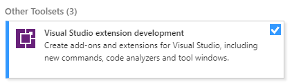
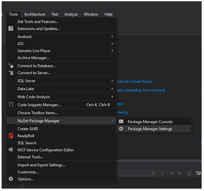
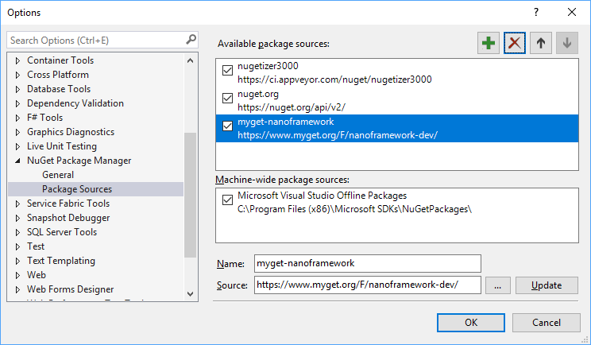
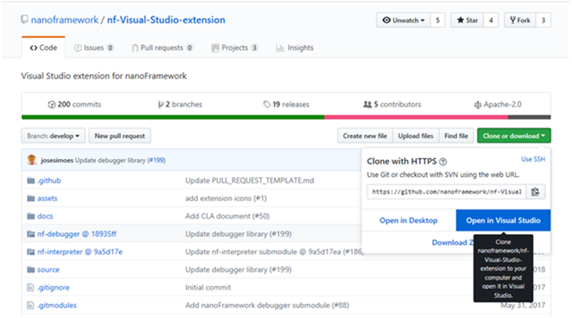
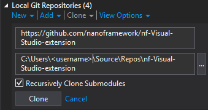
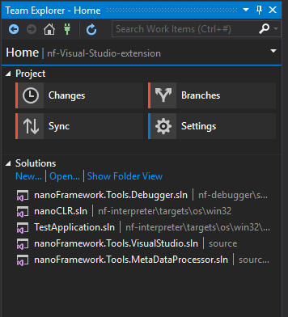
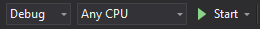
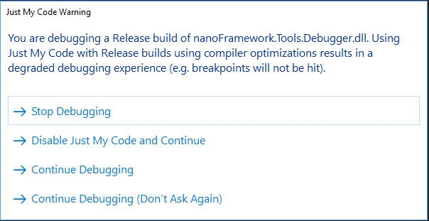
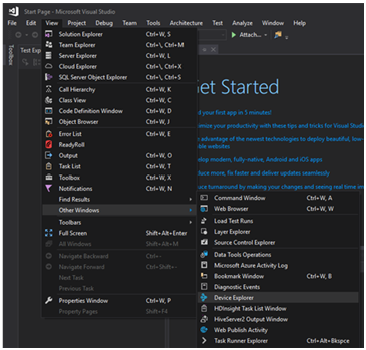
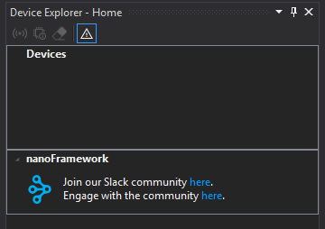

Although it has got easier over the years, debugging Visual Studio extensions is generally thought of as a dark art, this blog post is aimed at those people who wish get started. Specifically it is aimed at debugging the nanoFramework Visual Studio extension which will help us (with the aid of all willing volunteers) to improve the reliability of it.

**Step 1.** _**Ensure the Visual Studio Extension Development workflow is installed in VS2017:**_

This can be checked by running the "Visual Studio Installer" clicking Modify and scrolling to "Other Toolsets"

If the box is not ticked, please tick it and then click the "Modify" button in the bottom right corner. Depending on the workflows already installed, this modification will install quite quickly.

**Step 2. _Make sure that the Visual Studio 2017 nuget package source includes the MyGet feed for nanoFramework preview releases:_**

Open Visual Studio 2017 and browse to \[Tools -> Nuget Package Manager -> Package Management Settings\]

Click on Package Sources and then add a new package source by clicking the \[+\] button in the top right. You will then want to give the source an appropriate name such as "myget-nanoframework" and add the source "[https://www.myget.org/F/nanoframework-dev/](https://www.myget.org/F/nanoframework-dev/)".

Finally click \[Update\] and then \[OK\]

**Step 3. _Clone the nf-Visual-Studio-extension Repo from GitHub:_**

_Tip: if you wish to contribute and submit Pull Requests, it is more convenient to Fork the nf-Visual-Studio-extension Repo to your own GitHub account and Clone from there._

In your browser of choice, visit [https://www.github.com/nanoframework/nf-Visual-Studio-extension](https://github.com/nanoframework/nf-Visual-Studio-extension) and perform a clone choosing the appropriate method. In this example we will use the Visual Studio workflow.

_Note: if you have multiple versions of Visual Studio installed, you maybe asked which version to open. It is best to choose VS2017._

From the displayed Team Explorer window, change the install location (if required), and ensure the \[Recursively Clone Submodules\] option is checked

Then click clone.

**Step 4. _Open and Build the solution_**

From Team Explorer Home, open **nanoFramework.Tools.VisualStudio.sln**

Ensure \[Debug\] and \[Any CPU\] are selected and then click \[Start\]

This will first compile the source and then it will load an experimental instance of Visual Studio in addition to the one currently open.

_Optimisation: to improve the performance of the debug session, it is now possible to run experimental instance from the command line which can improve performance. A guide to doing this can be found [here](https://docs.microsoft.com/en-us/visualstudio/extensibility/the-experimental-instance)_

**Step 5: _Debugging the extension:_**

_Note: you should now ensure you have switched to the Experimental Instance for the rest of the guide._

A window will now pop up warning you that a release version of a DLL is being used

This is expected because the project is referencing the debugger library provided by the Nuget package. Click the \[Continue Debugging\] on the window.

_Note: if you need to step into the code of the debugger library, you will have to switch from the Nuget package to the local copy of the debugger project in the solution, to do this you can use [Nuget Package Switcher](https://marketplace.visualstudio.com/items?itemName=RicoSuter.NuGetReferenceSwitcherforVisualStudio2017)._

If the Device Explorer tool window is not present on the left of Visual Studio, Browse to \[View -> Other Windows -> Device Explorer\]

You should now use Visual Studio and the nanoFramework extension as you would.

If you find any exceptions or lockups, please provide the debug info from the Visual Studio instance running in the background to our [issues log](https://github.com/nanoframework/home/issues).

And that's it! Easy as pie, in fact the hardest part was probably the wait... So there are no excuses for saying that debugging a Visual Studio extension (including nanoFramework's) is too difficult!
