The [.NET nanoFramework GitHub](https://github.com/nanoframework) organization has 97 public repositories. While I am a huge fan of mono-repositories, I joined the project when there were already too many repositories to move to a mono-repository. It may happen in the future, who knows, but in the meantime, we're happy with our 97 repositories. They generate [230 nuget packages](https://www.nuget.org/profiles/nanoframework) and at the moment I write this blog post, more than [13 million downloads](https://www.nuget.org/profiles/nanoframework)! See the post done for the analysis when we reached the [2 million downloads milestone](/2-million-nuget-downloads-and-counting/).

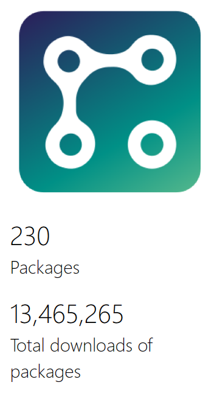

When you have multiple repositories, it's hard to get consolidated statistics. In a specific repository, you can easily see the number of PR, the number of contributors. But it's complicated as well to have an historical view over time, do advance analytics. So as for the nuget analysis, I decided to write few lines of codes to pull the statistics from GitHub and use Power BI to run the analysis.

## Pulling Commit statistics

I've been using the Octokit and the following few lines of C# to pull all our repository statistics:

```csharp
using Octokit;
using System.Text.Json;

const string token = "your token";

var client = new GitHubClient(new ProductHeaderValue("nanoStats"));
var tokenAuth = new Credentials(token);
client.Credentials = tokenAuth;
var repos = await client.Repository.GetAllForOrg("nanoFramework");

foreach (var repo in repos)
{
    Console.WriteLine(repo.Name);

    var commits = await client.Repository.Commit.GetAll("nanoFramework", repo.Name);
    List<GitHubCommit> gitHubCommits = new List<GitHubCommit>();
    foreach (var commit in commits)
    {
        var commitDetails = await client.Repository.Commit.Get("nanoFramework", repo.Name, commit.Sha);
        gitHubCommits.Add(commitDetails);
        // Needed not to exceed the threashold
        Thread.Sleep(250);
    }

    File.WriteAllBytes(Path.Combine("nanoFramework", $"{repo.Name}.json"), JsonSerializer.SerializeToUtf8Bytes(gitHubCommits));
}
```

From there, I generate then json files containing all the information I need. I've been sorting them a bit to take out those which are fork and where we dont really have any contribution.

At the end of the day, we do have 82 repositories. The size of the json vary depending on the activities:

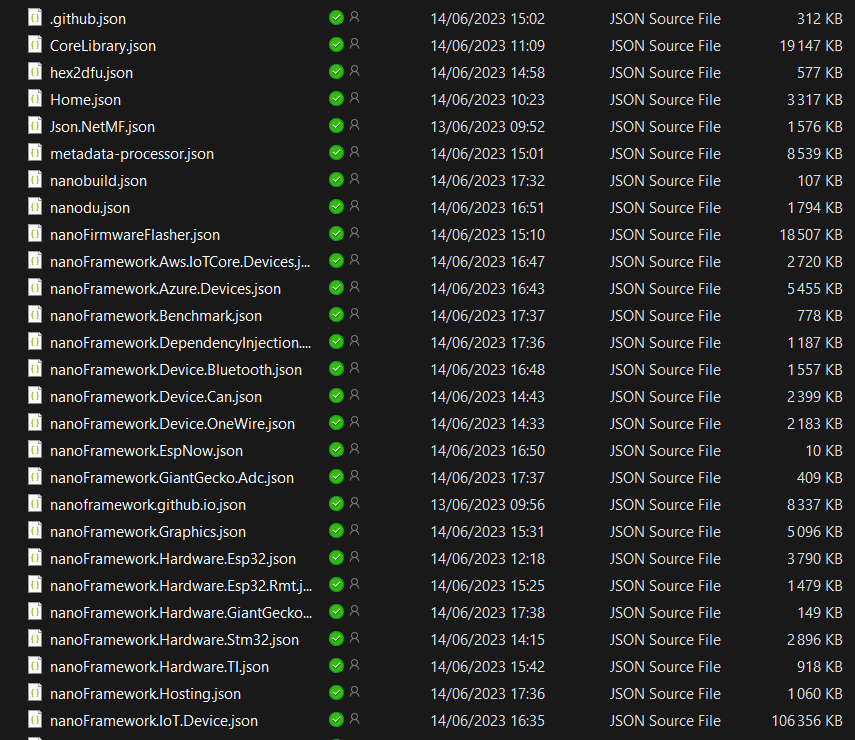

## The magic of Power BI

In Power BI desktop, you can load a folder and all the data it contains. Select "Folder" and hit "Connect":

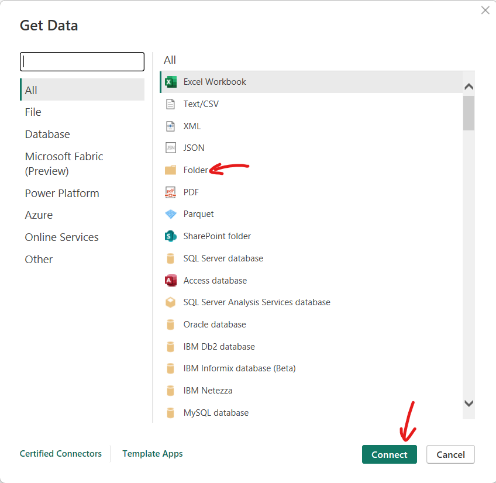

Then select your folder:

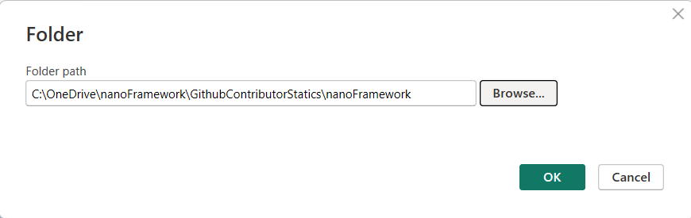

It will find out all the files, hit "Combine" and select "Combine and transform data":

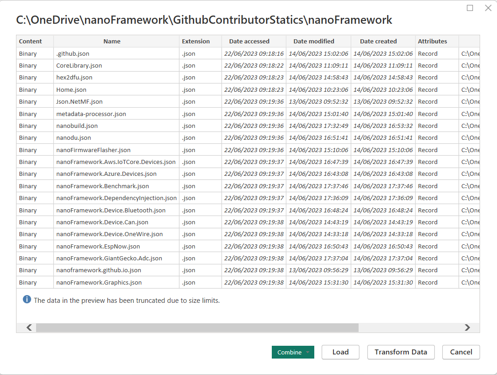

You then have something directly usable where objects have been expended like the Author one:

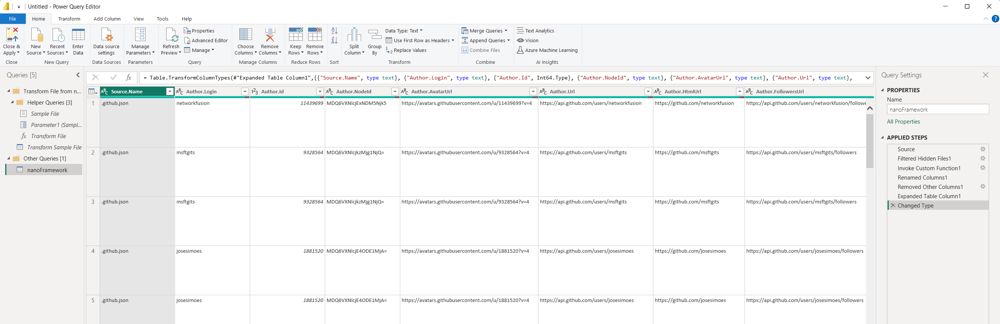

At that moment, you can do further transformation, adjust the name of columns, remove some. The "Source.Name" contains the name of the file which in our case is the name of the repository (with the json extension).

## Playing with the data

Let's just and quickly build a table that will who the author, the number of additions, deletions, and number of PR over time. In a matter of seconds, you can drag and drop fields, rename them to look nicer (you can do that directly on the data), adjust the avatar field to be displayed as a picture and you get:

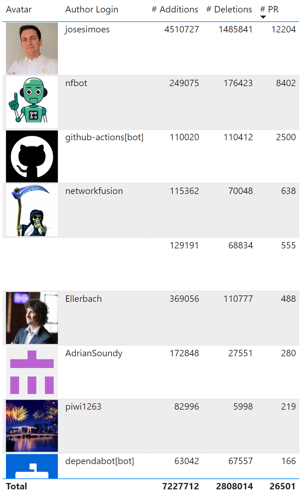

This table is for all the repositories where we have a production of nuget or related to the extensions or the build system. You can definitely see someone extremely active and without any surprise, the largest number of PR brought to .NET nanoFramework, the number of additions and deletions goes to José Simões. José is one of the creator of .NET nanoFramework and has been spending the last 7 years on making it what it is today.

What's interesting as well is to see the bots activities, 8402+2500+166+5 = 11073 = 41.7% of all PR! As José always says: "the machine should work for us, not the opposite!". The automation is pushed to all what can be automated: bump version on the extensions (Visual Studio and VS Code), bump on the tools, but also a fully update mechanism for all the lirbaries. Once let's say CoreLib is updated, you basically have to properly update the 250 nugets the proper way on about 80 repositories. That's the extreme case, most of the time, the impact is much smaller but still, you need this mechanism. And that's the reason why there are so many PR raised by bots.

OK, but that leaves 15428 PR raised by humans since the creation of .NET nanoFramework. So how, without the bots the history looks like:

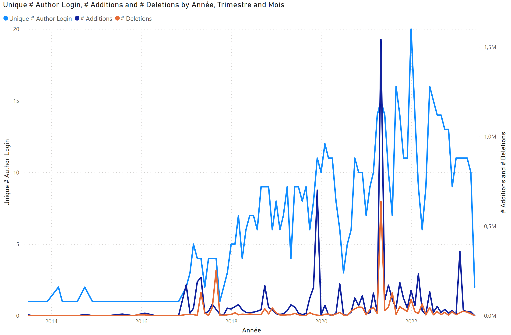

Wait, I wrote that .NET nanoFramework is 7 years old, but the actual data shows PR back from 2023, so 10 years ago. The reason is because of the early Json class which was .NET Microframework based and had already some contributions:

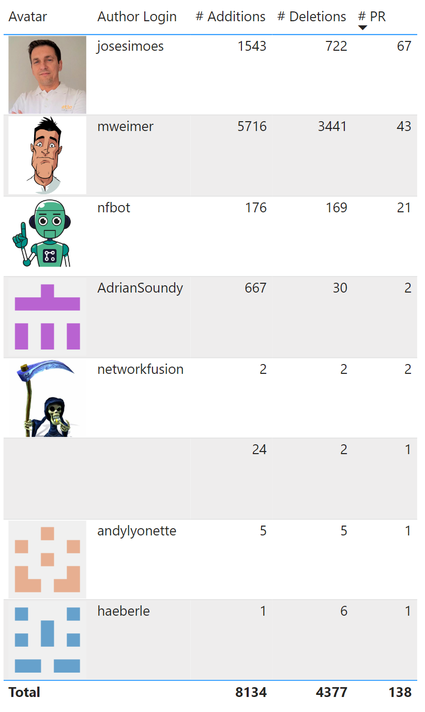

And here as well, you can find some know names like in the previous table: Adrian Soundy (AdrainSoundy), Robin Jones (networkfusion) who are part of the .NET nanoFramework core team and joined .NET nanoFramework very early.

What you can see as well is an empty contribution like in the previous table. So why is that? Well, there are actually a couple of people who contributed to the project but closed their account. The name details can be available as well as GithHub keep this data (you can of course ask to fully remove it), but it stays when you just close your account.

Now, what the graph shows us is, per **month**, the contribution of **unique contributors**, with additions and deletions. The graph is growing all over time with a nicely growing number of unique contributors. Again, the graph is without bots, only humans. The spike was in January 2022 with 21 unique contributors that month.

The additions and deletions spike goes for May 2021 with a record of 1.55M additions and 468K deletions! That is a month, we brought the .NET IoT repository bindings to .NET nanoFramework in the [Device.IoT](https://github.com/nanoframework/nanoFramework.IoT.Device) repository, migrating hundreds of bindings in some automatic way. That makes Robb Schiefer (rschiefer) on the main additions contributors as he helped a lot in this project helping to build tools to transform the code automatically while the number of PR is still good but still very far from José or myself as an example.

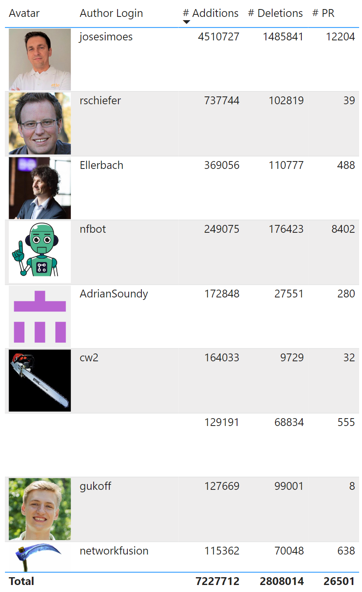

On the graph, you may notice a drop for the very last month, well, it's just because I did the extract early June and the month was not finished.

Let's focus on the full calendar year of 2022. Here is the table sorted by number of PR:

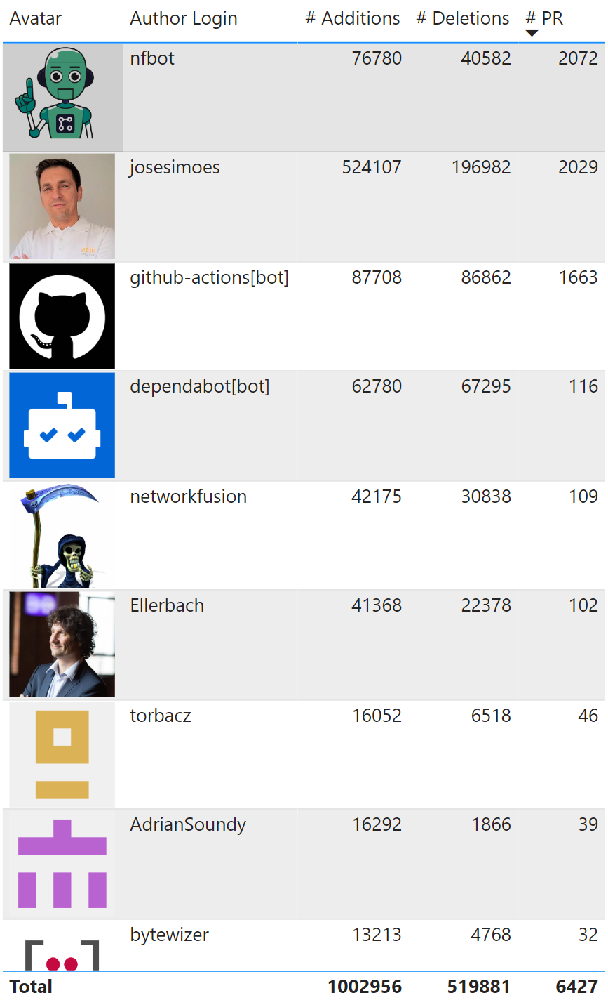

Let's remove the botas again: 2072+1663+116 = 3851 = 60% of all PR. This leaves 2576 PR raised by humans over the year. Ho wait, on 365 days, that's **7 PR per day, every single day of the year raised by 67 different humans**! If we remove the core team, this is still 297 PR raised by community contributors, so almost 1 PR every single day of the year.

## A healthy project

The numbers and the trends show a solid growth over time since the creation in 2017 and a consolidation of solid contributions for 2023. The fact we can get access to more data allows us to prove one more time the impact that .NET nanoFramework has.

It would be reductive to only look at the number of PR, the additions and the deletions for the health of the project. But it's a good indication of how the project is going. What we see now is more complex bugs to be fixed, more time spend on adding complex features which will most likely for 2023 show a decrease in the number of PR and additions/deletions. But that's going to be proof of maturity. And other datas like the number of bugs corrected will be a good indication of the maturity of the projects. The fast growing [13 million nuget](https://www.nuget.org/profiles/nanoframework) downloads is definitely a proof of adoption. As well as the very active [Discord channel](https://discord.gg/net-nanoframework-478725473862549535). So let's have another look at other data in bit to one more time prove that .NET nanoFramework is a stable, fast growing and production ready platform!
