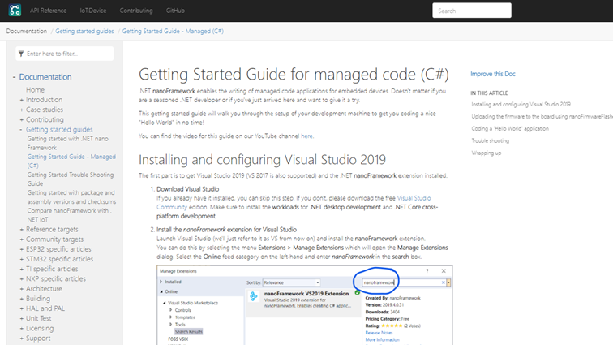
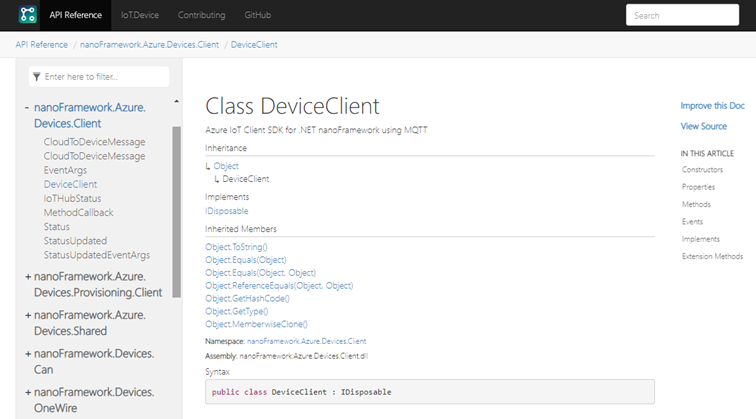
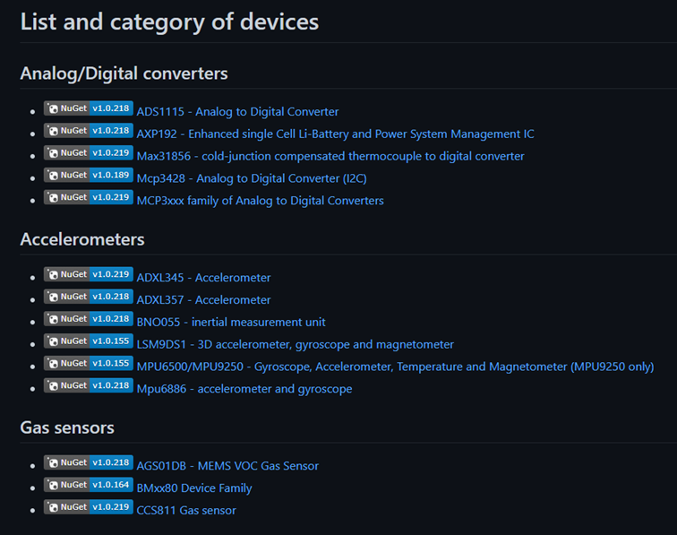
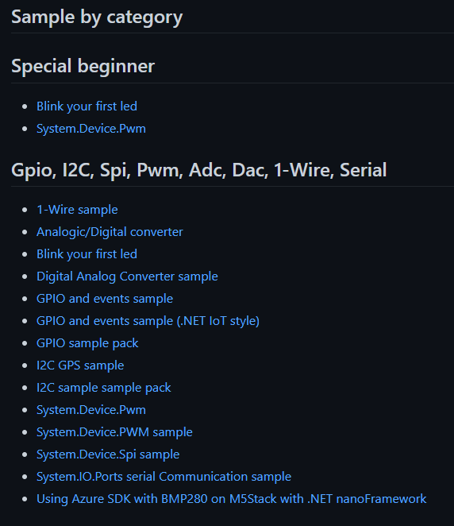
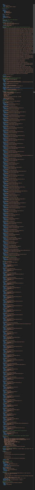

Developers ❤️ when documentations are available, detailed and easy to browse. In .NET nanoFramework we ❤️ developers. So we ❤️ when the documentation is the best! And we make all what we can to achieve this goal.

To create a great documentation, you need to put efforts of them. There is no secret. Efforts for building them, efforts for maintaining them, efforts to create new ones when there are open questions or to cover new features. And of course efforts to make them available in an easy way to consume.

As a developer you also want to make sure that you’ll not do manual maintenance when it can be automated, you want to reuse a maximum number of existing documents, in various forms like readme.md files, source code and any other format that can be available.

## docs.nanoframework.net

With [https://docs.nanoframework.net](https://docs.nanoframework.net), we’re trying to bring all this together. The docs website is generated from markdown files from our [nanoframework.github.io](https://github.com/nanoframework/nanoFramework.github.io) repository. As you’ll see when you’ll check out there, there is a collection of directories under the content folder containing Markdown files.

Those Markdown files represent only a part of the documentation we are generating. The files have been created over time and are maintained when something needs to be adjusted. As an example, with the recent update to Espressif IDF 4.3, we updated the articles related to ESP32, how to build, the device names, the getting started guide and few others. I would say, this is the traditional part of a documentation website.

The static html site is generated using [DocFX](https://dotnet.github.io/docfx/). DocFX allows you to transform Markdown files but as well build .NET code (and other technologies), extract the documentation from the code and generate pages. This is the same principle and core technologies Microsoft is using to generate all its documentation.

The result for the Markdown page transformation looks like this:



A table of content (TOC) is used to navigate the articles generated from the Markdown files. A dynamic TOC is as well available on the right allowing to go directly from one section to another. And you can notice a direct link to “Improve this Doc” is available allowing any developer to easily create a PR to improve it. Clicking on the link will bring you directly to the GitHub page.

This does involve to have clean and properly formed Markdown. Efforts have been made to have them as clean as possible. A deep cleaning with Markdownlint has been done. Soon the linter will be added to the pipeline to make sure the quality will remain with new articles.

Looking at the source code generation, you’ll get all the code documentation extracted. You know, the /// comments. We do make sure that they are as clear and as good as possible to have those docs as useful as possible.



That’s for the basic part. Now, all this creates some challenges: we all want everything to be as automated as possible. .NET nanoFramework has more than 80 repositories. They all contains one or multiple classes and namespaces.

Add to those the new [IoT.Device](https://github.com/nanoframework/nanoFramework.IoT.Device/tree/develop/devices) repository with another 80+ bindings (sensors, drivers), all representing multiple classes as well. Looking at this repository, you’ll find as well on the main README.md page a listing of all bindings. Going to the devices folder, another list sorted by categories. And if you go in any of the folder representing a binding, you’ll see another rich readme with the technical details, usage, documentation, Fritzing schema associated to the binding.

This is as well a lot of great documentation content you’d like to extract and add to the main documentation.

## Automating the IoT.Device device generation

As explained before the first challenge is to automate the device listing creation. You don’t want developers to adjust multiple readme, you just want them to focus on their code, adding great code /// comments and creating a perfect readme. The only thing we ask them is to add a little category.txt file with one or multiple categories their sensor is part of.

The rest is automatic. During the merge we have a [generator](https://github.com/nanoframework/nanoFramework.IoT.Device/tree/develop/src/device-listing) that will automatically adjust the main readme file and the devices folder one. The core part of the generator is coming from .NET IoT where it’s use to generate the list. It’s customized for nanoFramework. Each binding has its own nuget for example.

The generator is easy to add in the Azure build pipeline and is only triggered during a merge.

```yaml
- task: DotNetCoreCLI@2
  displayName: Adjust READMEs
  condition: and( succeeded(), eq(variables['System.PullRequest.PullRequestId'], ''))
  inputs:
    command: custom
    custom: run
    projects: '**/device-listing.csproj'
```

Another task will commit and push the changes back to GitHub.

```yaml
- task: PowerShell@2
  condition: and( succeeded(), eq(variables['System.PullRequest.PullRequestId'], ''))
  displayName: Push READMEs to GitHub
  continueOnError: true
  inputs:
    targetType: 'inline'
    script: |
      git config user.email 'nanoframework@outlook.com'
      git config user.name 'nfbot'

      git add README.md
      git add devices/README.md
      git commit -m "Update device lists" -m"***NO_CI***"

      git rebase origin/develop

      # compute authorization header in format "AUTHORIZATION: basic 'encoded token'"
      # 'encoded token' is the Base64 of the string "nfbot:personal-token"
      $auth = "basic $([System.Convert]::ToBase64String([System.Text.Encoding]::UTF8.GetBytes("nfbot:$(GitHubToken)"))))"
      git -c http.extraheader="AUTHORIZATION: $auth" push origin "HEAD:$(Build.SourceBranchName)"
```

The result looks like this:



The same principle has been used for the [Samples](https://github.com/nanoframework/Samples). Here the idea was to tag the samples with different categories, generate all this automatically as well. The developer just have to focus on its sample, a good readme and add a category.txt file. Leave the rest to the pipeline.



## Let’s reuse the IoT.Device readmes

The IoT.Device readmes are gold. They are rich of content, usage code, link on the binding documentation, most includes a Fritzing schema with an ESP32 or another nano supported device. So the core idea is to reuse them and include them directly into the docs.nanoFramework.net web site.

For this, we will as well use a tool that will take all the readme, transform all the links inside, move all the pictures and associated files. This tool will take any Markdown file from the repository, analyze all the links inside and adjust them.

If it’s a relative link, the link will be adjusted to point either directly on another Markdown part of the repository, either on the main GitHub repository if it’s something else. The good news is that the tool will find internal broken links, missing files as well. So we’re using as well to check the quality of what is checked in.

Pictures and attachments are moved as well in another directory to keep things as clean as possible for the generated html pages. Similar as for the previous tool, this one is as well an adaptation of .NET IoT. In .NET IoT it is still not used in the documentation, it will soon as well.

Now what? We can create folders with all this content. It still has to be added to the main documentation web site.

## Creating a TOC automatically

The challenge when you maintain a documentation web site is to maintain the TOC as well. Rename a page and you have to adjust the TOC. Add a new article and you have to add it to the TOC. Part of the [DocFX companion tools](https://github.com/Ellerbach/docfx-companion-tools) you’ll find a TOC generator. We will use this tool to generate both the main TOC and the IoT.Device TOC.

The tool is using the actual Markdown files title, the one following the first # tag in the file as the name in the entry. Now, there is as well the possibility to override it either because you want to simplify it either because you want to use characters not allow in a Markdown title.

One more feature is the ability to order the TOC and ability to ignore as well a folder. All those features are based on simple text files added in the repository.

So now we have all the tools we need, it’s time to put everything together.

## Pipeline my love

.NET nanoFramework makes an intense usage of Azure pipelines. Everything, literally everything that can be automated in Azure pipelines is.

And looking at the nanoFramework.github.io one, it’s a consequent one.



Feels long and complicated like this. Right? Well, it’s not. As stated initially .NET nanoFramework is using more than 80 repositories. So if you want to extract the code documentation, you’ll need to clone, restore the nugets, build every project. A large part of the pipeline is dedicated for this. For the rest, it’s about running our tools to generate the TOC, putting everything together, building the static website, pushing it to the artifact, that’s handy to debug and check all is correct, and of course committing and pushing the code to the nanoFramework.github.io static web site.

As a result, we have now 2 different TOC accessible side by side on the main page, one for the traditional docs, the other one dedicated to the IoT.Device readme. And all the nanoFramework API are build as well, including all the IoT.Device ones. Both accessible thru their own TOC as well.

The secret once you’re building and moving files in the directories is sitting in the [docfx.json](https://github.com/nanoframework/nanoframework.github.io/blob/pages-source/docfx.json) file. The metadata part is there to build and extract the source documentation. Excludes are possible to avoid building tests projects and tools which may be included in some of the repositories.

The build part is what is taking everything together. Selecting which directories to use to create the static files, as content like images. And the last secret sauce ingredient is the x-cross folder containing a special TOC that is used to display both the files coming from the traditional part and the ones from the IoT.Devices readmes.

Last but not least, the search feature makes it easy to find anything with couple of keywords.

## How to reproduce this for you?

As you’ve seen we’ve been using various tools to make the docs as solid as possible, fully building automatically. As all our repositories are MIT, you can feel free to pick any of those tools, adjust them for your needs and improve them.

That does include all the pipelines where you have all the code snippet you’ll need. And last but not least, you’ll find much [more companion tools for DocFX](https://github.com/Ellerbach/docfx-companion-tools) in my repository as well as in [Martin’s one](https://github.com/mtirionMSFT/DocFxQuickStart). Martin propose directly a full kit that can use as a starter kit containing a full sample, the pipelines, some documentations and everything to deploy.

.NET nanoFramework ❤️ documentation. We do ❤️ contributions as well to improve them! We still have some ideas how to improve them and make them even better for our developers. With what we put in place, you as a developer may find inspiration as well. We’re here to make developer life easier and I hope that this article will help you ❤️ docs as well 😉
