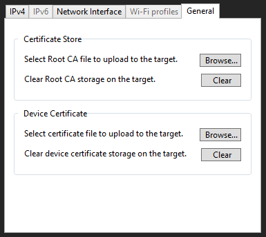

Network connections are a key feature for use case scenarios that require… connectivity. Nothing too surprising so far, right?

Because of this, being able to easily handle network connection and configurations is something that developers working on such projects value a lot.

Today we would like to present some improvements that have just been added to the .NET nanoFramework network API and features list.

### **Device Certificate storage**

It is now possible to store a device certificate in the device internal storage.

Device certificates can be used to authenticate a device when connecting to [Azure IoT Hub](https://azure.microsoft.com/en-us/services/iot-hub/), for example. Or, if the device is acting as a web server, to present itself as _the_ valid device to connect to.

Up until now, to use device certificates, one would have to store them in a removable storage or if the certificate was in the application resources, it would require compiling a different application for each device.

To upload a device certificate, you need to go to Device Explorer in Visual Studio, open the Network Configuration dialog and move to the last tab.

We are looking into improving the nanoff CLI to allow automated uploading of these in production scenarios.

### **Use of A device certificate**

The next question might be "how to use this device certificate?"

We have given some thought to this in order to make it as easy as possible, and not disruptive at all.

Because the device certificate is usually a secret, we would not want to expose it unnecessarily. Adding to this and because the storage of the certificate can be in a secure location (depending on the target), it had to be handled at the lowest possible level.

With all these constrains and not wanting to change the well-known APIs like [AuthenticateAsClient(...)](https://docs.nanoframework.net/api/System.Net.Security.SslStream.html#System_Net_Security_SslStream_AuthenticateAsClient_System_String_System_Security_Cryptography_X509Certificates_X509Certificate_System_Net_Security_SslProtocols_) and [AuthenticateAsServer(...)](https://docs.nanoframework.net/api/System.Net.Security.SslStream.html#System_Net_Security_SslStream_AuthenticateAsServer_System_Security_Cryptography_X509Certificates_X509Certificate_System_Net_Security_SslProtocols_) the choice was to add a new property to the [SslStream](https://docs.nanoframework.net/api/System.Net.Security.SslStream.html) class: `[UseStoredDeviceCertificate](https://docs.nanoframework.net/api/System.Net.Security.SslStream.html#System_Net_Security_SslStream_UseStoredDeviceCertificate)`.

When this is set to true, the magic happens at the lowest possible level, deep in the network layer at the firmware. How? When the [SslStream](https://docs.nanoframework.net/api/System.Net.Security.SslStream.html) is setting up the authentication step, it will try to retrieve the device certificate stored and use it.

Note that "**try"** is used in the sentence above. The code will really **attempt** to retrieve the certificate from the device storage and use it. If it is not there, it will continue as if no certificate was provided and whatever the outcome is, it will be handled by the application.

It is worth noting that setting this new property and parsing a certificate in any of the API calls above, will have the effect that the certificate parsed in the parameter will be ignored and the one stored internally will be used. This is valid for both server and client.

### **Improved information about network availability**

Currently, in order to know if there is an active network connection, the options available by our API were limited to subscribing to the [NetworkAvailabilityChanged](https://docs.nanoframework.net/api/System.Net.NetworkInformation.NetworkAvailabilityChangedEventHandler.html) event or checking if there was an IP address assigned to the network interface.

The event is nice to have during the application execution but is not that useful at boot time because, for most devices and network connections, the network connection will become available almost instantaneously and, when it fires the event, the application may not have had time yet to setup the event handler, so it goes unnoticed.

The [System.Net.NetworkInformation](https://docs.microsoft.com/en-us/dotnet/api/system.net.networkinformation) namespace in full .NET has an API to help with this: [NetworkInterface.GetIsNetworkAvailable()](https://docs.nanoframework.net/api/System.Net.NetworkInformation.NetworkInterface.html?q=GetIsNetworkAvailable#System_Net_NetworkInformation_NetworkInterface_GetIsNetworkAvailable). Now we have it too!  
Oh yes: to know if network is available at any time, it is a simple matter of calling this method. Convenient, isn’t it?

This call will return `true` if there is a network connection available on any of the network interfaces in the system. Considering that the vast majority of .NET nanoFramework devices and applications has (or uses) a single network interface, this means that calling it will be all that is needed to know if the device has an active network connection or not!

### **Easy access to device IP address**

Another pain point was the ease of access to the device IP address. With what was available, in order to find out the current IP address of the device, one would have to go the usual (and lengthy) act of: 1) grab the network interfaces collection 2) loop through them to access the IP address 3) extract the IP address. Works fine, but I think we are all in agreement that it could be easier…

So, again, and looking at the full .NET API, there is a method to help with that too. That is IPGlobalProperties.GetUnicastAddresses(). Because we are the **nano**Framework and we do not need all the fancy stuff that is there, we came up with a similar call that provides the IP addresses of all the network interfaces in the device: [IPGlobalProperties\_GetIPAddress()](https://docs.nanoframework.net/api/System.Net.NetworkInformation.IPGlobalProperties.html?q=IPGlobalProperties#System_Net_NetworkInformation_IPGlobalProperties_GetIPAddress). Which, again, because most devices will have only one, will provide straightforward access to the IP address of the only network interface available.

### **Performance (and size) improvements**

If there is a matter where there are (usually) no disagreements: that is performance. Everyone prefers that the application runs quicker and smoothly.

Now, in the process of adding all these new features, debugging them and all that, several code blocks that where begging for improvement where spotted. This resulted in a review and a complete rewrite of a couple of cases. In the end, a performance improvement on several subsidiary calls (like `Parse()` and `ToString()`) was accomplished along with a significant decrease of several hundred bytes in the size of the library code. All this without any penalty in the native code.

### mbedTls updated to latest available version

And last, but not the least, [mbedTls](https://github.com/ARMmbed/mbedtls) was updated to the latest available version (v2.26.0). Being a security related component, it is important to keep it updated for the obvious reasons. And here it is: the latest and greatest improvements and fixes are now available in .NET nanoFramework firmware.

Samples have been updated to reflect and benefit from the changes. The network helper class, in particular has been simplified because of these new APIs.

All in all, these are small but important improvements that will make life easier to everyone working with network. Enjoy it!
