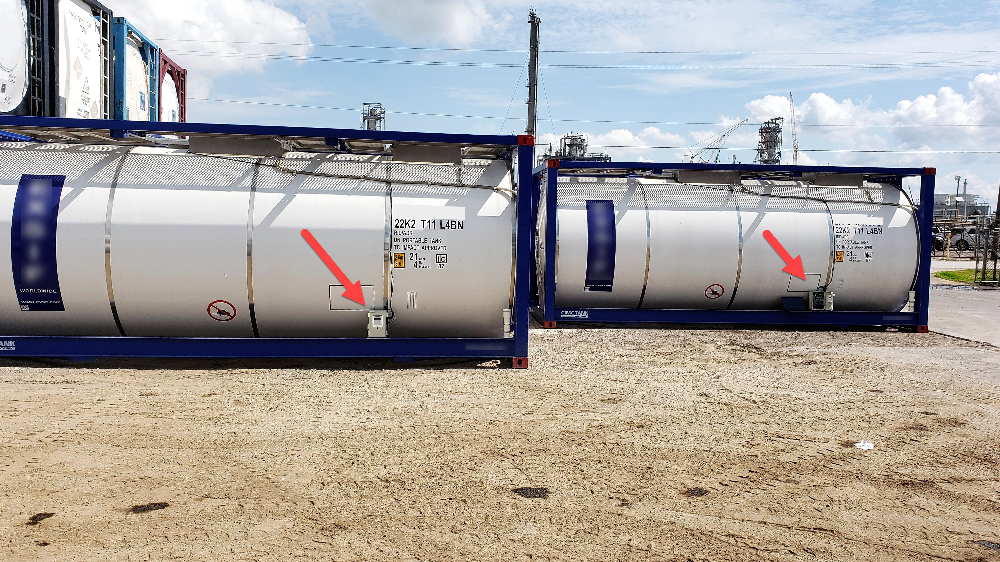
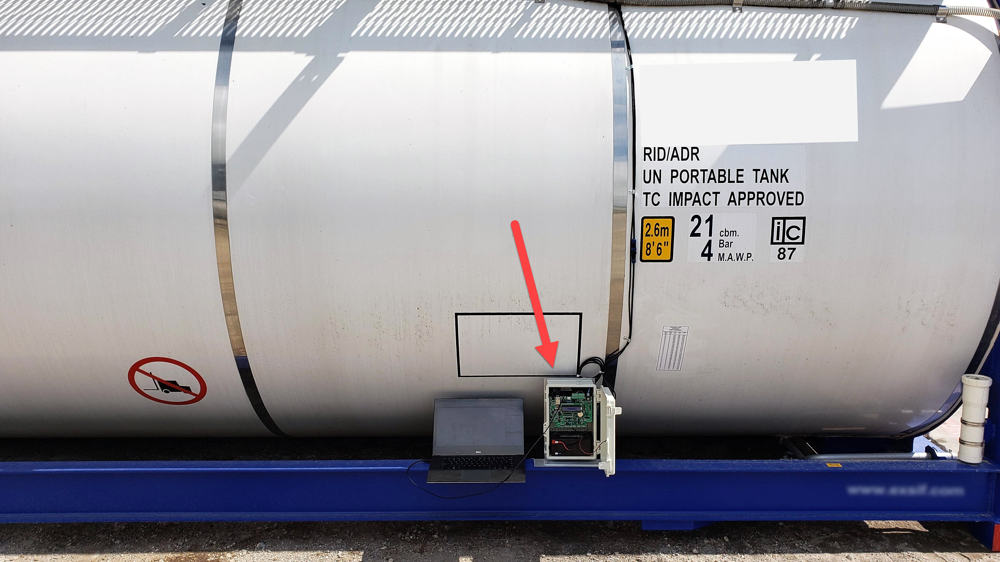
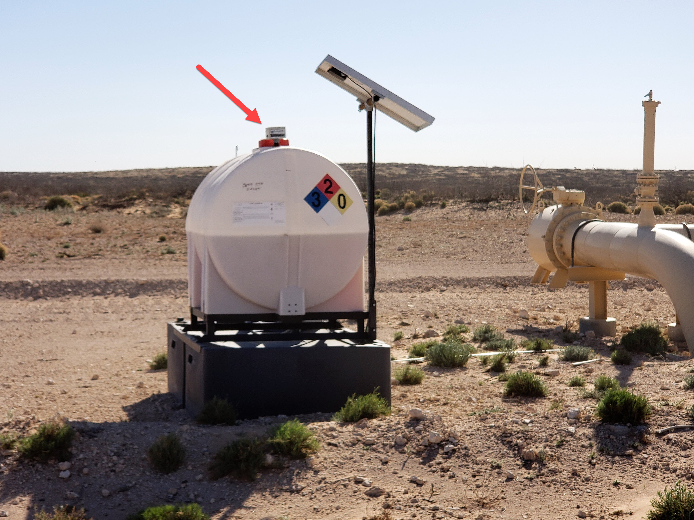
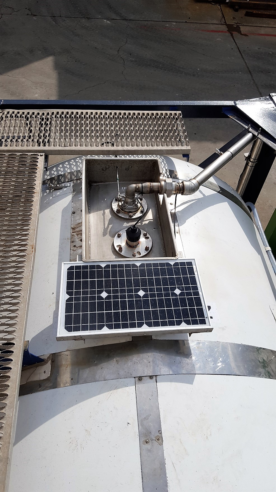
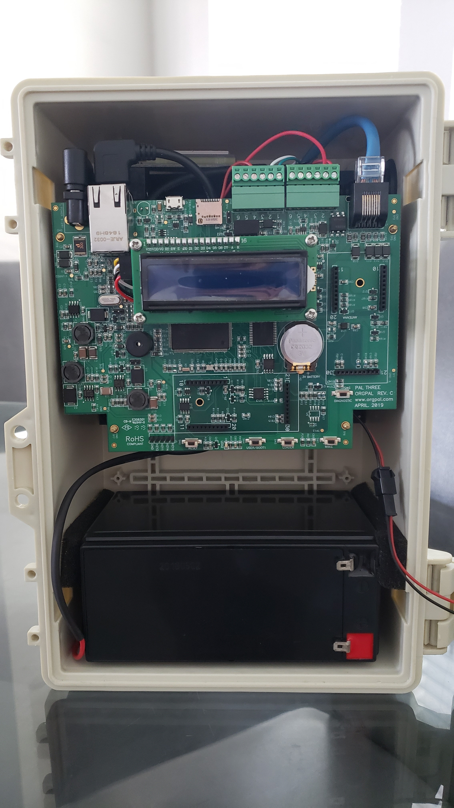

The first commercial products with the “**nanoFramework** inside” label (a shameless copy of the old Intel® logo) are out in the wild! Literally.  
They were built to perform in a demanding industry and deployment scenarios: oil fields! These devices have been developed and built by [OrgPal](https://www.orgpal.com/), a leading remote-monitoring manufacturer and solution provider for the oil and gas industry.

OrgPal entered the market in 2013 and since then, the company has designed three generations of remote monitoring equipment, providing solutions to many oil and gas companies across North America. The solution is called [PalThree](https://www.orgpal.com/solutions-tank-level-monitoring).

Energy field services and operations require regulatory compliance as well as accurate and frequent monitoring. For oil and gas companies the challenge is finding a cost-effective, reliable system and not all telemetry systems are created equal.

Zan Gligorov, CEO of [OrgPal Telemetry](https://www.orgpal.com/), has explained to us the reasoning behind their choice.

“Our objective was to create a modern, simple, easy-to-install and use device that could easily integrate with the hundreds of sensors from the most modern to already existing across oil fields in North America. Our hardware met those goals, but we needed a great firmware platform to match it, and nanoFramework made that possible.

Many solutions use different components from many manufacturers to integrate a solution, leading to a costly solution and even more costly maintenance option. The technology is not compatible by design and given that they are deployed in distant hostile environments with limited or no access to terrestrial communications - and no electrical power supply - maintenance becomes very costly over time.

Because nanoFramework is so feature rich yet easy to use, has small footprint (it fits on tiny MCU’s), our solution is efficient with the lowest power consumption in the industry. We were able to use a very high power STM32 MCU, integrate a complete satellite receiver with antenna, on board flash/file system, USB, cellular support, RTC and more for a very powerful remote measurement system, with low energy footprint.

The resulting PalThree based solution is a game-changer for the industry.”

Checkout some photos from the real thing.

_Tanks in staging area_

_Close up on tank with PalThree_

_Tank fitted with PalThree deployed in the desert_

_Solar panel powering PalThree_

_Palthree in product enclosure_

Cool isn't it? :)

Are you using **nanoFramework** on a commercial product too? Please let us know and join the club [here](https://1drv.ms/xs/s!AnbQmclZwQHagSzU74bS4uOTLxsc)!
