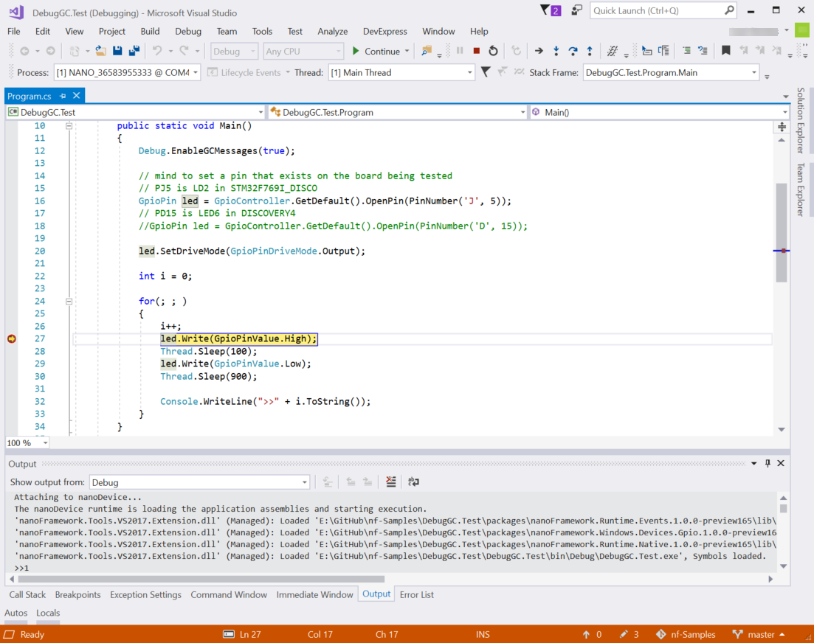
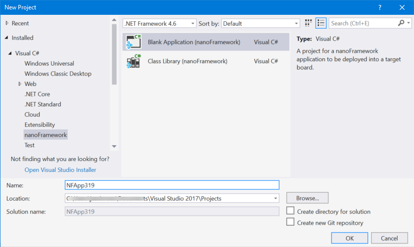
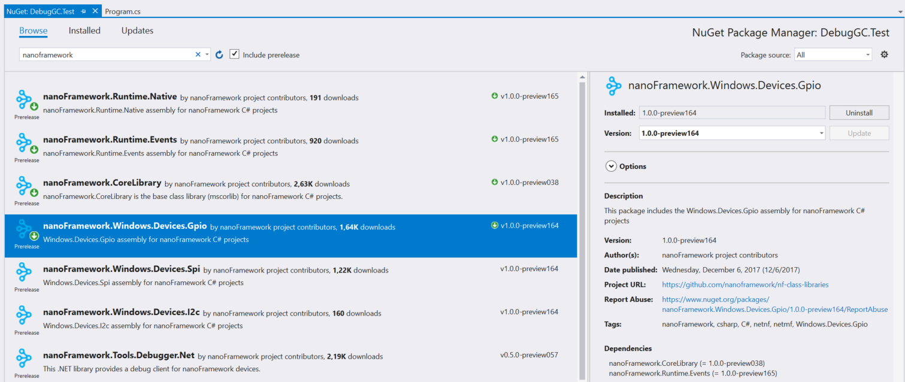
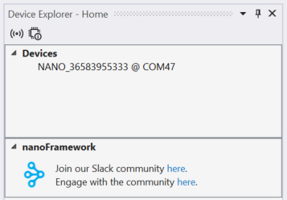

Today the **nanoFramework** project hit a major milestone: we’ve released a new version of our [Visual Studio extension](https://marketplace.visualstudio.com/items?itemName=vs-publisher-1470366.nanoFrameworkVS2017Extension). What's so special about that I hear you ask... Well it is the first one with the capability of debugging managed code!

Many will think that this is not a big feat, but it is. It has taken a year of hard work during which a lot of code was rewritten, cleaned-up and brought up to modern coding standards. There are still some rough edges to improve, but it’s very usable now.

The way **nanoFramework** interacts with Visual Studio when compared with the original .NETMF has changed quite substantially. Here’s a brief summary.

1\. The project system was completely rewritten and it’s now based in the new Visual Studio Project System Extensibility.

2\. There is no SDK to install. Everything is packaged inside the Visual Studio extension. That’s all a developer needs to start coding and debugging with **nanoFramework**.

3\. All libraries are distributed as Nuget packages. This make it so much easier to consume, distribute, update and manage dependencies and versioning.

4\. The Wire Protocol component, used to communicate with target devices, was completely rewritten and is now using modern WinRT APIs. The current version supports USB but it can be easily expanded to support legacy UART COM ports and also networked connected devices. This communication component is also responsible for a huge performance improvement making all the operations lightning fast. For example, the deployment of a managed project takes just a few seconds.

5\. There is no MFDeploy anymore. A developer can perform all the required interactions with connected devices without leaving the comfort of Visual Studio using the Device Explorer Window.

6\. The debug engine and the Wire Protocol components are now available as Nuget packages making them very easy to reuse in third party applications, production automation and other uses.

Now there is one less excuse to start delving into **nanoFramework**, please pull the repos and contribute with some PRs. 😉

Happy holidays and happy coding with **nanoFramework**!
