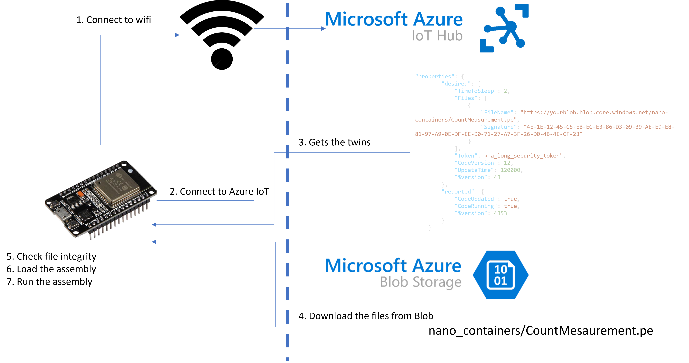

Over the Air (OTA) is the equivalent of a Windows Update or package update in Windows or Linux but in the Micro Controller Unit (MCU) world. While OTA word can be used in other circumstances, it is mainly in the Internet of Things (IoT) world that the term can be found. You can as well hear about In Field Update.

The goal is to be able to update the running code without having to get the device back to a manufacturer or having to move it in any way. You may have to be able to connect to the device, especially if this one is not connected to a network.

OTA usually takes the form of a firmware update and a code update. The firmware is the equivalent of the small Real Time OS and some of the lower layer while the code is what runs on it. The mechanism in place is usually about being able to load the new update on an internal storage, in parallel of a the actual version. And then, making the change of the running code. And if anything is wrong during the new code loading, with a watchdog, being able to go back to the other version.

In terms of security and integrity, you need to make sure that the new update is properly signed and integer when downloading it.

And of course, you need a mechanism that is easy to put in place to be able to download those data safely without having to move the device. When you have a network connectivity, you can take advantage of it and use it. When you don’t, you need another mechanism which can be played by a local area network like Bluetooth or plugging in a cable.

In the pattern I’ll explain here for .NET **nanoFramework**, we will look at how to update the running code in a secure way. This will not cover the firmware update but rather the code running code that you’ll write in C#. For this, we will leverage the network connectivity like Wi-Fi or Ethernet with [Azure IoT](https://azure.microsoft.com/en-us/overview/iot/).

The code can be accessed in the [.NET **nanoFramework** samples](https://github.com/nanoframework/Samples/tree/main/samples/AzureSDK/AzureEdgeOta).

In short, the pattern I’ll describe more in details later on is to be able to download new code from a blob storage using the advantages of Azure IoT with the twins as a mechanism to distribute the information. Add to that the magic of .NET with reflection and dynamic assembly loading and you get the main key points. Now, enough theory, let’s dig into the code.



[.](https://github.com/nanoframework)[NET **nanoFramework**](https://github.com/nanoframework) offers .NET support on small MCU like ESP32, STM32, TI and NXP. As the memory footprint is very limited, the storage as well, you can imagine it’s not a full .NET you can run but rather an optimized version, with some compatibility from the code point of view with the large .NET versions.

This pattern is fully compatible with [Azure IoT Plug & Play](https://docs.microsoft.com/en-us/azure/iot-develop/overview-iot-plug-and-play) as well. It is not used here just for simplification reasons.

# Azure IoT: secured and reliable connection to the cloud

With the current MCU, you’ll start to get a lot of connectivity embedded in those, including ways to support TLS and other security mechanism. Take a simple ESP32, it has for a few euros/dollars, a Wi-Fi connection, a possible Bluetooth one and for some boards also a wire one. I am taking this example as they are easy to find and present in many home automation devices you can buy. They are as well relatively easy to find.

But why would you connect such a small device to the cloud? Well, because you can! And in many cases, it makes more sense to use a direct connection than gateways and special connectivity to reach out the gateway. Working on the Manufacturing and Automotive industries, I see more and more opportunities to give a digital life to some old instruments for a very low cost. A lot of old measurement instruments have a simple serial communication allowing to gather the measurement for example. All those MCU have a serial port you can use to connect and as a proxy to gather the instrument data. This is giving intelligence and an ability to connect to the factory floor network for a very cheap and maintainable cost.

Other more obvious scenarios are the infield usage in remote places where the connection can be done through a cellular network or even a low bandwidth and long range one like LoRa.

A lot of people ask me why not connecting a larger device like a Raspberry Pi instead. Well, it’s a matter of cost, consumption efficiency as well. You won’t be able to have something as big as a Raspberry Pi working on a small solar panel with a small battery. You’ll already require something much larger. And you’ll increase drastically your cost by a factor of 5, 10, up to 100 times more for a simple function.

.NET **nanoFramework** offers the possibility to connect to a network, in a secure way, supporting TLS and certificate authentication with Azure IoT. Few lines and you’ll be able to connect using our [Azure SDK](https://github.com/nanoframework/nanoFramework.Azure.Devices):

```csharp
// We are storing this certificate in the resources or directly on the device
X509Certificate azureRootCACert = new X509Certificate(Resource.GetBytes(Resource.BinaryResources.AzureRoot));
azure = new(Secrets.IotBrokerAddress, Secrets.DeviceID, Secrets.SasKey, MqttQoSLevel.AtLeastOnce, azureRootCACert);
```

In this example, we’re using a SAS token, you can use a certificate as well. If you are using a certificate, .NET **nanoFramework** offers the possibility to flash it independently than the code. It does offer the equivalent or a certificate store.

# Azure Twins: give me what to download

The concept of [Azure Twins](https://azure.microsoft.com/en-us/services/digital-twins/) used in Azure IoT is to be able to play the role of properties you can send to a device at any time. You have \`desired\` and \`reported\` properties. You can use them really as you like. Those are JSON representations. Here is an example:

```json
{    
    "properties": {
        "desired": {
            "TimeToSleep": 2,
            "Files": [
                {
                    "FileName": "https://blob_name.blob.core.windows.net/nano-containers/CountMeasurement.pe",
                    "Signature": "4E-1E-12-45-C5-EB-EC-E3-86-D3-09-39-AE-E9-E8-81-97-A9-0E-DF-EE-D0-71-27-A7-3F-26-D0-4B-4E-CF-23"
                }
            ],
            "Token": "A SAS token to connect to the blob storage",
            "CodeVersion": 12,
            "UpdateTime": 120000,
            "$version": 43
        },
        "reported": {
            "CodeUpdated": true,
            "CodeRunning": true,
            },
            "$version": 53
        }
    }
}
```

While you can place any information, this is not a mechanism to distribute large files or large content. It should be used for simple purposes, like in this example. We can see we can use it already to give URL, security token, versions, and some other elements.

A connected device to Azure IoT can request those twins and subscribe to changes on them. Using the .NET **nanoFramework** Azure library, it is very straight forward:

```csharp
var twins = azure.GetTwin(new CancellationTokenSource(10000).Token);
if (twins == null)
{
  // Do something
}
// Subscribe to the twin change
azure.TwinUpated += TwinUpdated;
void TwinUpdated(object sender, TwinUpdateEventArgs e)
{
  // Do something
}
```

When, you’ll ask for the twins with \`GetTwins\`, you’ll get both the desired and the reported ones. You can then report any change based on the desired state and the current reported one. While when you subscribe to updates, you’ll logically only get the desired ones.

# Blob storage: secured, versioned and easy to access

Blob storage provides an easy and secure way to store any kind of unstructured data. Adding to this that there is a file versioning and the cost is extremely cheap. This is usually what is used for large data lake. Here, we will use Blob storage to place our build code to be dynamically loaded later once on the device. .NET **nanoFramework** in the build chain uses the classic MS Build and then there is a specific work done to transform the Intermediate Language (IL) into something that can be executed by the .NET **nanoFramework** Common Language Runtime (CLR).

Accessing a Blob storage requires a specific access token that can be generated per container (equivalent of a directory) or per file. The duration of the token can be the length you want. But for security purposes, it is better to have it relatively short and renewed often. The token is derived from a main Sas token to access the full storage. This add a great security mechanism.

In our case, we will give both the files to download and the access token in the twins. While the Azure twin storage is secure, it is better to have the access token for a limited duration anyway. The device integrity may have been damaged. In that case, you’ll only be able to have access for a short period of time to those files and nothing else. If anything wrong happens to the device, you can always adjust the files to download and provide a new token.

Accessing a blob storage is done using HTTPS. Here is how you can do that in .NET **nanoFramework** and store it on a SD card or the internal flash:

```csharp
string fileName = url.Substring(url.LastIndexOf('/') + 1);
// If we are connected to Azure, we will disconnect as small devices only have limited memory
if (azure.IsConnected)
{
    azure.Close();
}

httpClient.DefaultRequestHeaders.Add("x-ms-blob-type", "BlockBlob");
// this example uses Tls 1.2 with Azure
httpClient.SslProtocols = System.Net.Security.SslProtocols.Tls12;
// use the pem certificate we created earlier
httpClient.HttpsAuthentCert = new X509Certificate(Resource.GetBytes(Resource.BinaryResources.azurePEMCertBaltimore));
HttpResponseMessage response = httpClient.Get($"{url}?{sas}");
response.EnsureSuccessStatusCode();

using FileStream fs = new FileStream($"{RootPath}{fileName}", FileMode.Create, FileAccess.Write);
response.Content.ReadAsStream().CopyTo(fs);
fs.Flush();
fs.Close();
response.Dispose();
```

This code is very straight forward, the only thing you should make sure is to use the special header to add to the request. Then storing the file is mainly about reading it by chunks and storing it to the file system.

Each file comes with a SHA256 signature. This is to ensure that the download happened properly. This hash mechanism is a great way to check that nothing has been adjusted in the file or that it has been downloaded properly. In our case, we are mainly interested in the proper download as the rest of the chain is fully secured. We will see right after how to check the integrity right before loading the assembly in the CLR.

# Assembly.Load: dynamically load your .NET assembly

Something that always fascinate me in .NET  is the ability to use reflection and dynamically load assemblies. This has always been a complex problem that the IT industry has been chasing for years. And with .NET this was a clear advantage since the beginning with reflection. It is the ability to get the information on any class you can load. The method names, the properties but also being able to call them.

Add to this the ability to dynamically load an assembly from a file, and now, you start to understand how we will run our code dynamically. From the previous steps, what we’ve been doing is storing the assembly in the internal storage or an SD card. Time to load all of them.

```csharp
// Now load all the assemblies we have on the storage
var files = Directory.GetFiles(RootPath);
foreach (var file in files)
{
    if (file.EndsWith(".pe"))
    {
        using FileStream fspe = new FileStream(file, FileMode.Open, FileAccess.Read);
        Debug.WriteLine($"{file}: {fspe.Length}");
        var buff = new byte[fspe.Length];
        fspe.Read(buff, 0, buff.Length);
        // Needed as so far, there seems to be an issue when loading them too fast
        fspe.Close();
        fspe.Dispose();
        Thread.Sleep(20);
        bool integrity = true;
        string strsha = string.Empty;
        // Check integrity if we just downloaded it
        if (filesToDownload != null)
        {
            integrity = false;
            var sha256 = SHA256.Create().ComputeHash(buff);
            strsha = BitConverter.ToString(sha256);
            var fileName = file.Substring(file.LastIndexOf('\\') + 1);
            foreach (FileSettings filesetting in filesToDownload)
            {
                if (filesetting.FileName.Substring(filesetting.FileName.LastIndexOf('/') + 1) == fileName)
                {
                    if (strsha == filesetting.Signature)
                    {
                        integrity = true;
                        break;
                    }
                }
            }
        }

        if (!integrity)
        {
            Debug.WriteLine("Error with file signature");
            TwinCollection reported = new();
            reported.Add(CodeRunning, $"{IntegrityError}:{file} - {strsha}");
            azure.UpdateReportedProperties(reported);
            break;
        }

        var ass = Assembly.Load(buff);
        var typeToRun = ass.GetType(OtaRunnerName);
        if (typeToRun != null)
        {
            toRun = ass;
        }
    }
}
```

In this code, we will read every file fully and pass it to the Assembly.Load which will load them in memory. At this point, no code is executed. It is just loaded. And before loading them, we are checking the integrity of the code. If anything even a bit has changed somewhere in the code, the signature will be different.

## The dynamic assembly: finding the entry points

One of the class is a bit special and will be our entry point. That is the code which we will call with a start function when it is supposed to be running and a stop function when we need to stop it. It does contain as well a twin update function. The public exposed functions looks like that:

```csharp
namespace CountMeasurement
{
    public static class OtaRunner
    {
        public static void Start(DeviceClient azureIot)
        public static void Stop()
        public static void TwinUpdated(TwinCollection twins)
    }
}
```

While there is the possibility to have the same code non static, as it is supposed to be executed by the main code only once, this is a reasonable choice. There are private static variables associated as well and private functions to keep track of the various objects. Having them static will make them cleaned by the garbage collector once the functions would be called.

```csharp
// Now load the assemblies, they must be on the disk
if (!isRunning)
{
    LoadAssemblies();

    isRunning = false;
    if (toRun != null)
    {
        Type typeToRun = toRun.GetType(OtaRunnerName);
        var start = typeToRun.GetMethod("Start");
        stop = typeToRun.GetMethod("Stop");
        twinUpated = typeToRun.GetMethod("TwinUpdated");

        if (start != null)
        {
            try
            {
                // See if all goes right
                start.Invoke(null, new object[] { azure });
                isRunning = true;
            }
            catch (Exception)
            {
                isRunning = false;
            }
        }
    }
}
```

While loading the assemblies, we tried to find the main one based on its name. We then find the methods, Start, Stop and TwinUpdated. And we just start our application by calling the Start method passing the azure DeviceClience as an argument. See the section on how to improve this part for even more flexibility.

The Stop method is called when the code needs to be updated while the TwinUpdated one is as soon as there are changes on the twins.

The TwinUpdated function looks like this:

```csharp
private const string UpdateTime = "UpdateTime";

// Any of the private fields must be static as the class is NOT created
private static CancellationTokenSource _cancellationTokenSource;
private static DeviceClient _azureIot;
private static int _updateTime = 60000;
private static Thread _runer;
private static long _count = 0;

public static void TwinUpdated(TwinCollection twins)
{
    Debug.WriteLine("Twin update");
    if (twins.Contains(UpdateTime))
    {
        _updateTime = (int)twins[UpdateTime];
        Debug.WriteLine($"Update time: {_updateTime}");
    }
}
```

The start function:

```csharp
public static void Start(DeviceClient azureIot)
{
    Debug.WriteLine("Start called");
    _cancellationTokenSource = new();
    _azureIot = azureIot;
    // Get the twins
    Debug.WriteLine("Getting twins");
    var twins = _azureIot.GetTwin(new CancellationTokenSource(10000).Token);
    Debug.WriteLine("Having twins");
    if ((twins != null) && (twins.Properties.Desired.Contains(UpdateTime)))
    {
        _updateTime = (int)twins.Properties.Desired[UpdateTime];
        Debug.WriteLine($"Update time: {_updateTime}");
    }

    Debug.WriteLine("Running...");
    _azureIot.AddMethodCallback(GetCount);
    _azureIot.SendMessage($"{{\"state\":\"Code {nameof(CountMeasurement)} verion: 4 running...\"}}");
    _runer = new Thread(() => Runner());
    _runer.Start();
}
```

The function is a simple counter and will send the counter status to Azure IoT every period of time defined by the UpdateTime desired property.

What is interesting here is that we can as well use the support of [Direct Method](https://docs.microsoft.com/en-us/azure/iot-hub/iot-hub-devguide-direct-methods) offered by Azure IoT. The line \`\_azureIot.AddMethodCallback(GetCount);\` and the associated function directly send the answer back to Azure IoT:

```csharp
private static string GetCount(int rid, string payload)
{
    Debug.WriteLine("Get Memory called");
    // Ignore the payload, we will just return the count available
    return $"{{\"Counts\":{_count}}}";
}
```

This code is very simple and of course, it can be much more complex, reading sensors, accessing GPIO, SPI, I2C, Serial or anything else. It can use nugets as well and any other code. All the libs not present yet into your device will have to be uploaded to the blob storage and downloaded on the device.

As a result you’ll be able to see something like this in the debug output of Visual Studio:

```
Step into: Stepping over non-user code 'Program.'
Program Started.
Connecting to wifi.
Date and time is now 02/28/2022 10:02:10
The thread '<No Name>' (0x4) has exited with code 0 (0x0).
The thread '<No Name>' (0x6) has exited with code 0 (0x0).
The thread '<No Name>' (0x3) has exited with code 0 (0x0).
The thread '<No Name>' (0x5) has exited with code 0 (0x0).
Can seek: False, Lengh: 2300
Total bytes read: 2300
The nanoDevice runtime is loading the application assemblies and starting execution.
I:\CountMeasurement.pe: 2300
   Assembly: CountMeasurement (1.0.0.0)   (468 RAM - 2300 ROM - 820 METADATA)

   AssemblyRef    =       12 bytes (       3 elements)
   TypeRef        =       60 bytes (      15 elements)
   FieldRef       =        0 bytes (       0 elements)
   MethodRef      =       84 bytes (      21 elements)
   TypeDef        =       24 bytes (       3 elements)
   FieldDef       =       20 bytes (       9 elements)
   MethodDef      =       28 bytes (      14 elements)
   StaticFields   =       84 bytes (       7 elements)

   Attributes      =        0 bytes (       0 elements)
   TypeSpec        =        0 bytes (       0 elements)
   Resources       =        0 bytes (       0 elements)
   Resources Files =        0 bytes (       0 elements)
   Resources Data  =        0 bytes
   Strings         =      858 bytes
   Signatures      =      128 bytes
   ByteCode        =      496 bytes

Total: (22704 RAM - 245512 ROM - 97249 METADATA)

   AssemblyRef    =      248 bytes (      62 elements)
   TypeRef        =     2236 bytes (     559 elements)
   FieldRef       =       60 bytes (      15 elements)
   MethodRef      =     3556 bytes (     889 elements)
   TypeDef        =     4088 bytes (     511 elements)
   FieldDef       =     1888 bytes (     937 elements)
   MethodDef      =     6404 bytes (    3190 elements)
   StaticFields   =     1284 bytes (     107 elements)

   DebuggingInfo  =     3232 bytes

   Attributes      =      120 bytes (      15 elements)
   TypeSpec        =       36 bytes (       9 elements)
   Resources Files =       24 bytes (       1 elements)
   Resources       =       24 bytes (       3 elements)
   Resources Data  =     1782 bytes
   Strings         =    48684 bytes
   Signatures      =    13845 bytes
   ByteCode        =    95062 bytes

*** No debugging symbols available for 'CountMeasurement'. This assembly won't be loaded in the current debug session. ***
The thread '<No Name>' (0xb) has exited with code 0 (0x0).
Start called
Getting twins
Having twins
Update time: 120000
Running...
In the thread
Sending telemetry... Counts: 1
Sending telemetry... Counts: 2
Sending telemetry... Counts: 3
```

What is interesting to see is that once the CLR is loading an assembly, you can see the different elements related to it, it will happen with any assembly loaded. In this case, we load only one but nothing prevent you to load multiple ones.

So far, the .NET **nanoFramework** extension does not allow you to debug the dynamically loaded code. You can follow the different debug message in the code and see how things evolve.

Once the telemetry is starting, you’ll see the debug message in the output window. You can use [Azure IoT Explorer](https://docs.microsoft.com/en-us/azure/iot-fundamentals/howto-use-iot-explorer) for example to check that all is working as expected and you’ll start seeing messages like this one:

```
Mon Feb 28 2022 08:08:17 GMT+0100 (Central European Standard Time):
{
  "body": {
    "Counts": 2
  },
  "enqueuedTime": "Mon Feb 28 2022 08:07:17 GMT+0100 (Central European Standard Time)"
}
Mon Feb 28 2022 08:07:17 GMT+0100 (Central European Standard Time):
{
  "body": {
    "Counts": 1
  },
  "enqueuedTime": "Mon Feb 28 2022 08:07:17 GMT+0100 (Central European Standard Time)"
}
```

You can check as well all the properties of your twins and see the various updates.

# Limitations and possible enhancements

This pattern can be improved to add safety mechanism, storing the new files aside the previous version, making sure it can be loading and if yes, removing them. In our case, a simple mechanism reporting that the code has been properly updated has been put in place and reporting that it is running. If not running after some time, and if no telemetry, you can always ask to download the previous version for example. This can be automated with [Azure Function](https://docs.microsoft.com/en-us/azure/azure-functions/functions-overview) and [Azure Monitor](https://azure.microsoft.com/en-us/services/monitor/) for example.

This has been tested and developed on devices with low RAM and low storage. This is the reason why the device reboots once it has downloaded the assemblies. And the reason why the previous version of the files are deleted before downloading the new versions. This can be improved by loading the new assembly without rebooting for devices with larger memory and in the same way, keeping the previous version before deleting those. The management of the file is by group, all or none when it comes to the update. A simple file versioning system based on the file name containing the versioning would allow more flexibility and to update only one file.

Size does matter and the smaller the best. As all assemblies are loaded into the memory, first from the storage then to the CLR, keep it small. It is better to load 4 assemblies of 5K bytes each than 1 of 20K bytes. This does reduce the pressure on the memory especially for devices with no PSRAM like the basic ESP32. It is for the same reason that the signature is checked only while loading the assembly and not while saving it. We optimize this pattern for the devices with limited RAM. As in all cases, in case of issue, the full download can be forced again. Now, on a more limited network, this would be of course optimized to only download the missing component.

On the reflection side, the current code is looking for specific function names’ entry points, assembly name and is fairly simple. It is of course possible to have something more generic using some attributes to find the propre entry points wherever they are in the classes and whatever their name is. The current code uses only one main entry point but again, with attributes, we can imagine having multiple ones. You’ll just have to be careful with the assemblies dependencies and making sure that you will update properly all the impacted files as well.

# Where to start

To setup your device like an ESP32, install the Visual Studio extension and write your first few C# .NET nanoFramework lines of code, check our [getting](https://docs.nanoframework.net/content/getting-started-guides/getting-started-managed.html) [started guide](https://docs.nanoframework.net/content/getting-started-guides/getting-started-managed.html).

To start with [Azure](https://docs.microsoft.com/en-us/azure/iot-hub/) [IoT](https://docs.microsoft.com/en-us/azure/iot-hub/) and learn more about it for .NET **nanoFramework**, checkout the [detailed documentation and the code repository](https://github.com/nanoframework/nanoFramework.Azure.Devices).

And of course, you’ll find the the [.NET **nanoFramework** samples](https://github.com/nanoframework/Samples/tree/main/samples/AzureSDK/AzureEdgeOta) with the OTA code, an application to automatically publish the needed PE files and generate the twin to add to your device on this repository.

Enjoy and, as always, feedback is welcome.
