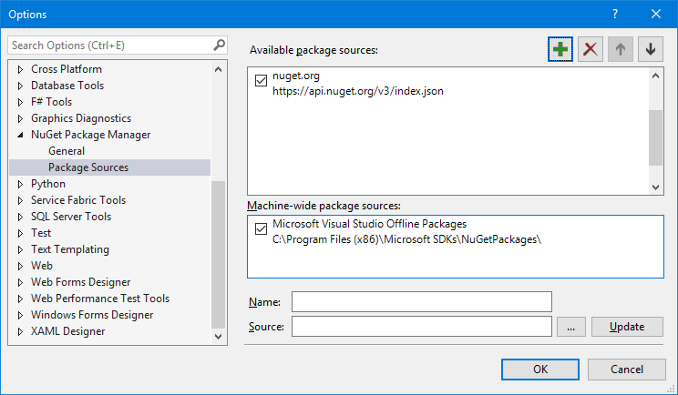
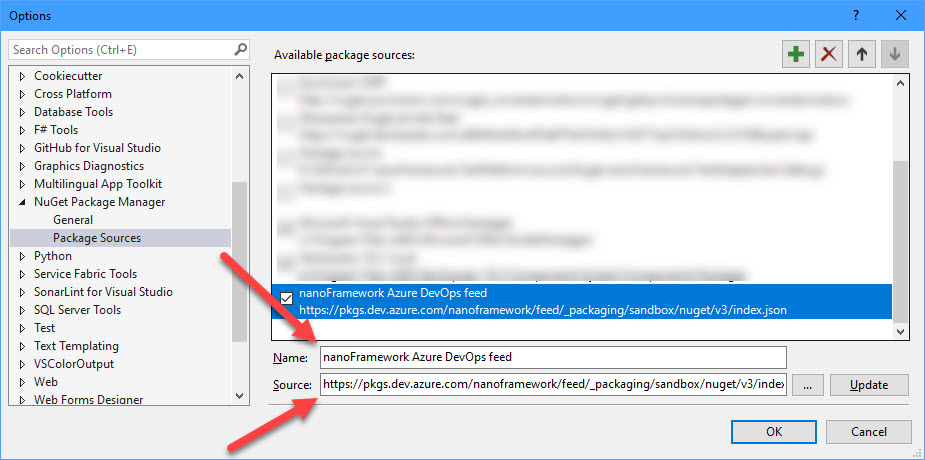
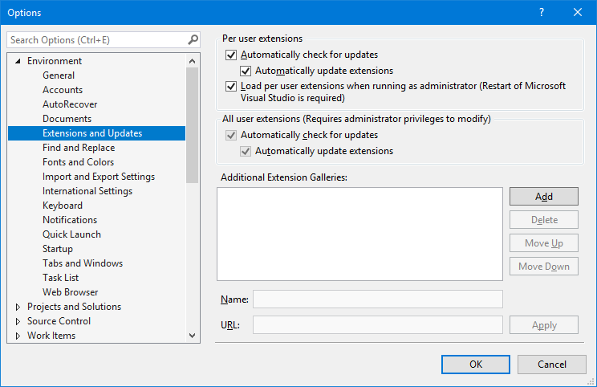
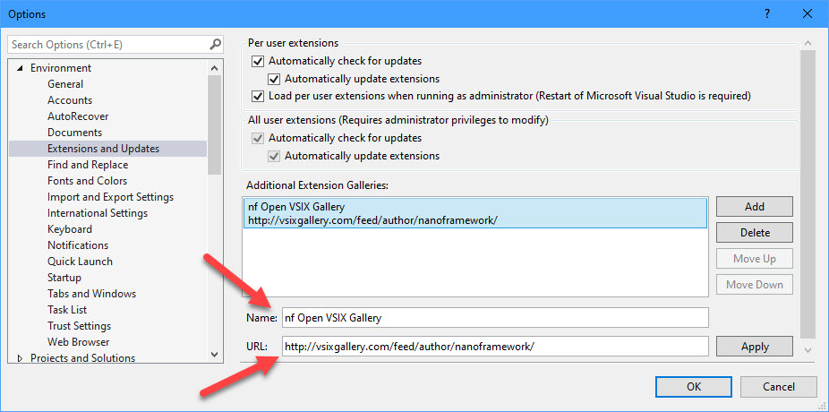

_(updated on 2019-08-21)_

If you are one of those developers that like to have access to the shiny and newer versions of the components you use, this post is for you.

It also applies if you are testing a PR for one of the class libraries or one of the experimental develop branches.

A bit of background information first to put you in context.

All the official (or labelled stable) releases of our Nuget packages are distributed through [Nuget](https://www.nuget.org/packages?q=nanoframework). The same goes for the Visual Studio extension. It’s distributed through the [Visual Studio Marketplace](https://marketplace.visualstudio.com/items?itemName=vs-publisher-1470366.nanoFrameworkVS2017Extension).

All the above works just fine with the default Visual Studio configuration and settings. So nothing particularly thrilling so far…

Now, if you're after the good stuff you’ll want to setup your Visual Studio to access nanoFramework's developer feed. This feed hosted in [Azure Artifacts](https://azure.microsoft.com/services/devops/artifacts/) from our [Azure DevOps](https://azure.microsoft.com/services/devops/) account.

Actually, there are two different feeds: one for the Nuget packages and another one for the Visual Studio extension.

### Azure ARTIFACTS Nuget feed

If you want to add this feed to your Visual Studio, just follow the following steps.

1.       Open Visual Studio Options window (available in Tools menu).

2.       On the Options window navigate on the left-hand toolbar to Nuget Package Manager – Package Sources.



3.       Click on the add button (the big green plus sign on the top right) and enter a name for the package source along with the following URL:

```
https://pkgs.dev.azure.com/nanoframework/feed/_packaging/sandbox/nuget/v3/index.json 
```

4.       Click on the **Update** button otherwise your changes won’t’ be effective.



5.       That’s all. From now on this feed will be included on the searches and update checks on the Nuget Package manager.

_Note 1: Make sure that you have this new source selected in the Package Source filter in the Package Manager (top left corner), otherwise it won't be included in the search._

_Note 2: in case you are looking for a Nuget package of a PR you are testing, for example, you’ll find those with the alpha suffix. If there is more than one, check the release date for disambiguation._

### Open VSIX Gallery

1.       Open Visual Studio Options window (available in Tools menu)

2.       On the Options window navigate on the left-hand toolbar to Environment – Extensions and Updates.



3.       Click on the Add button at the right and enter a name for the gallery source along with the following URL:

```
 https://vsixgallery.com/feed/author/nanoframework/
```

4.       Click on the Apply button otherwise your changes won’t’ be effective.



5.       That’s all. From now this gallery will be included on the searches and update checks for your Visual Studio Extensions and Updates.

And that’s all folks! Now you can easily access the fresh new packages as they get out of our [Azure Pipelines](https://azure.microsoft.com/pt-pt/services/devops/pipelines/) builds.
