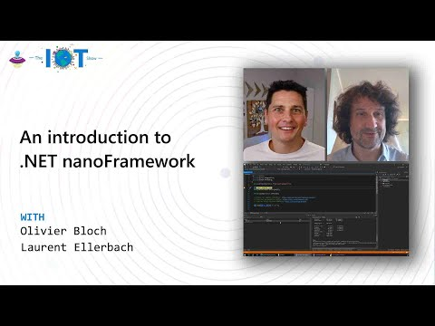

.NET **nanoFramework** is a [free and open-source](https://en.wikipedia.org/wiki/Free_and_open-source_software) platform that enables the writing of managed code applications for constrained [embedded devices](https://en.wikipedia.org/wiki/Embedded_system). It is suitable for many types of projects including IoT sensors, wearables, academic proof of concept, robotics, hobbyist/makers creations or even complex industrial equipment. It makes the development for such platforms easier, faster and less costly by giving embedded developers access to modern technologies and tools used by desktop application developers.

Developers can harness the powerful and familiar [Microsoft Visual Studio IDE](https://www.visualstudio.com/vs/) and their [.NET](https://en.wikipedia.org/wiki/.NET_Framework) [C#](https://en.wikipedia.org/wiki/C_Sharp_\(programming_language\)) knowledge to quickly write code without having to worry about the low-level hardware intricacies of a microcontroller. Desktop .NET developers will feel “at home” and are able to use their skills in embedded systems development, enlarging the pool of qualified embedded developers.

It includes a reduced version of the .NET [Common Language Runtime](https://en.wikipedia.org/wiki/Common_Language_Runtime) (CLR) and features a subset of the .NET base class libraries along with the most common APIs included in [.NET IoT](https://docs.microsoft.com/en-us/uwp/api/) allowing code reuse from .NET IoT applications, thousands of code examples and open source projects.  
Using Microsoft Visual Studio, a developer can deploy and debug the code directly on real hardware.

|     |     |
| --- | --- |
| The project is supported by the .NET Foundation. |  |

You can watch this video from the Microsoft [IoT Show](https://aka.ms/iotshow) featuring .NET nanoFramework connected to Azure IoT Hub, measuring a [BMP280 sensors](https://docs.nanoframework.net/devices/Iot.Device.Bmxx80.Bmp280.html) and using the unique deep sleep feature from microcontrollers. A real life example with .NET nanoFramework:

